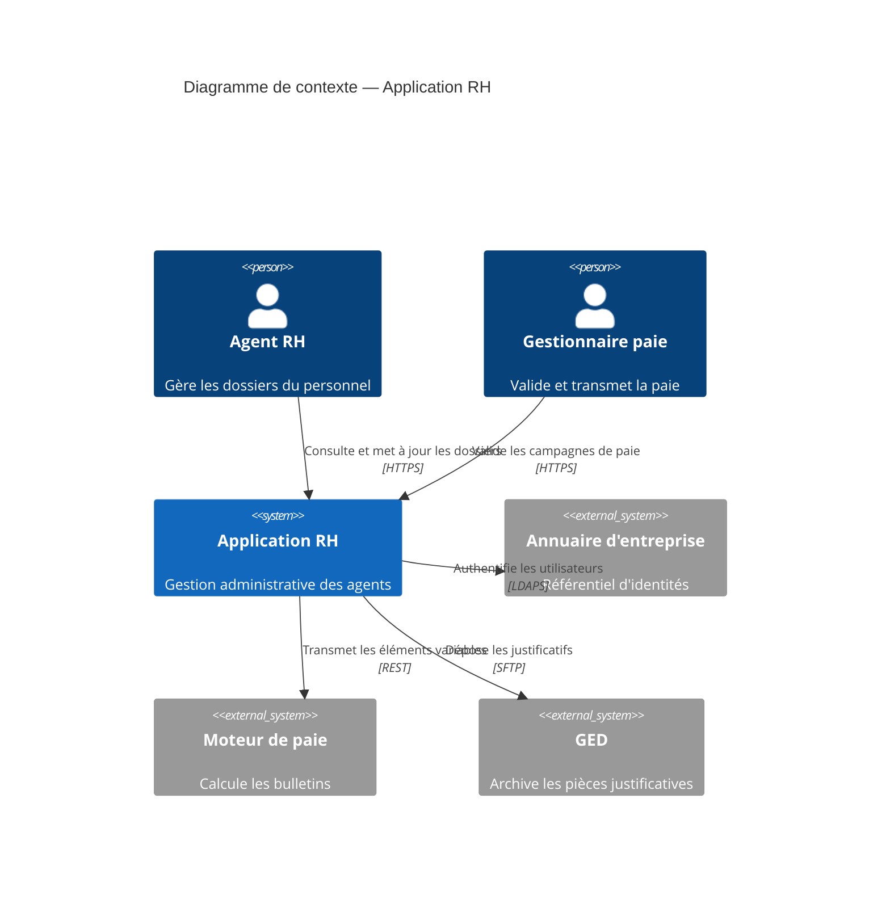
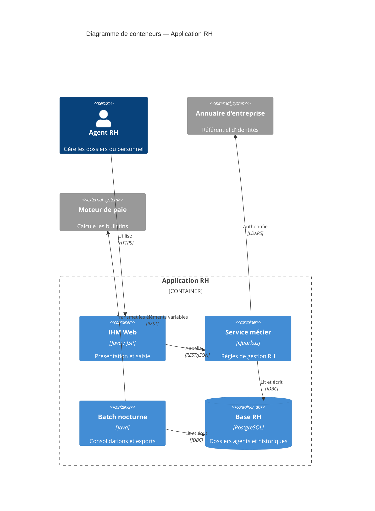
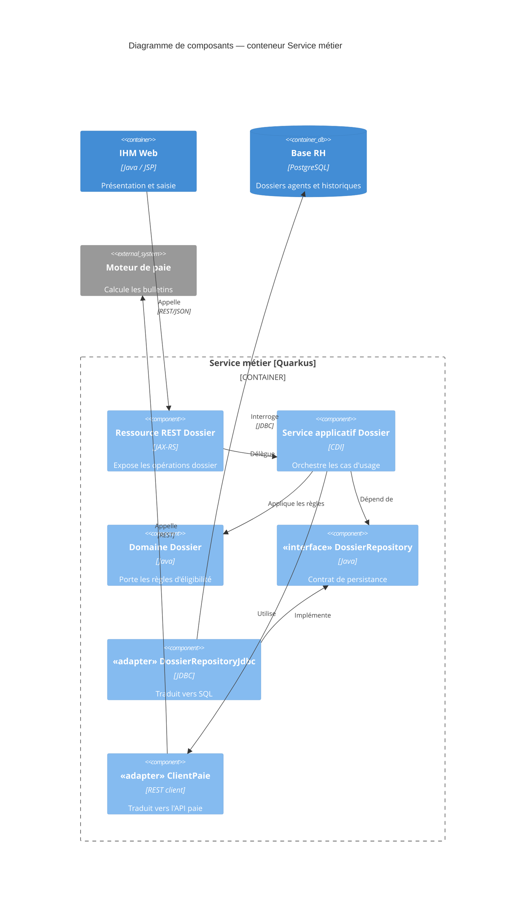
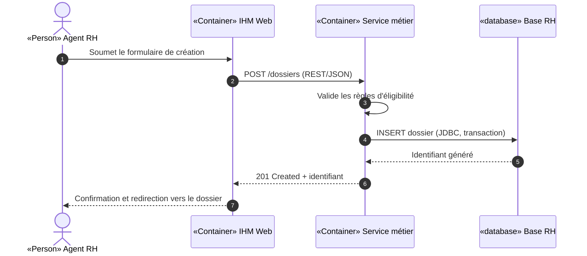
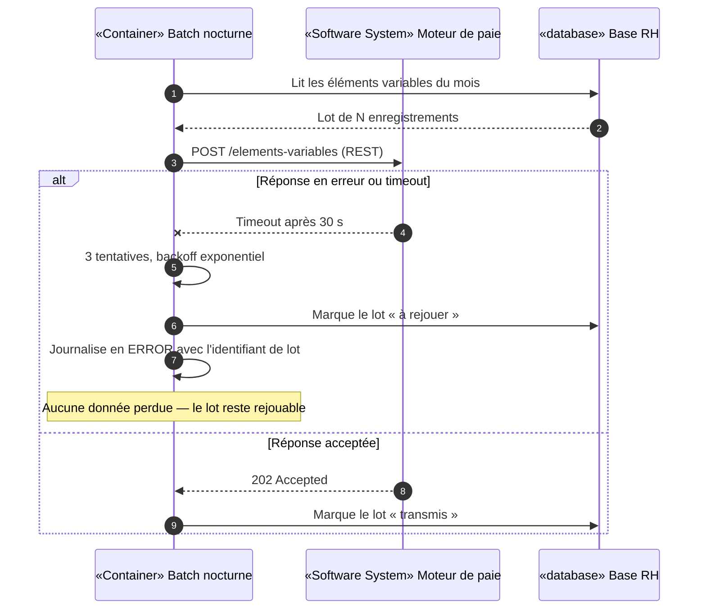
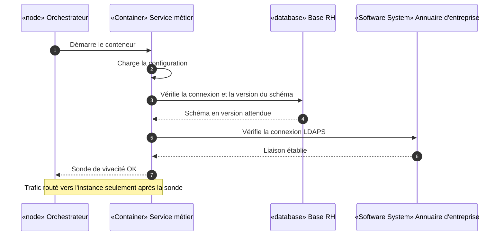
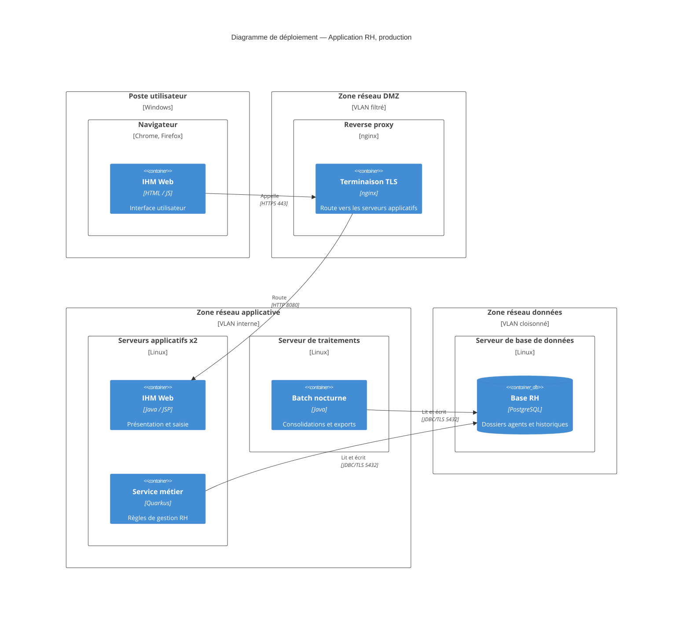
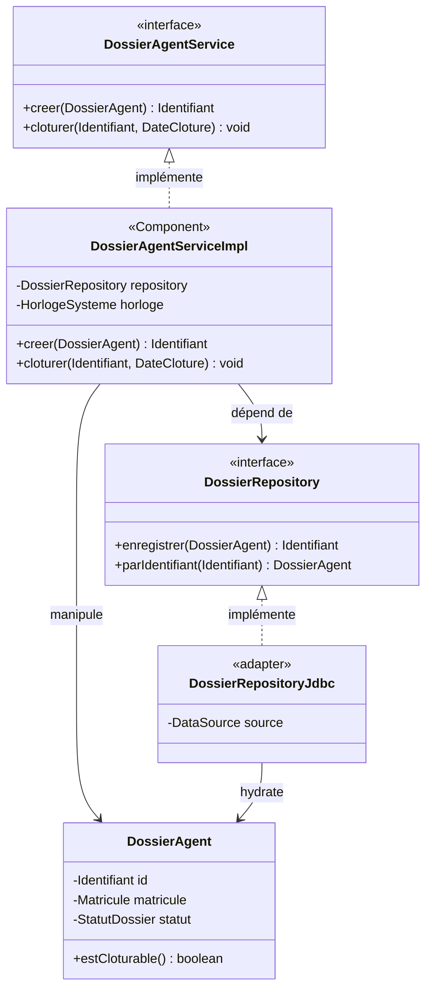

# Patterns Mermaid — C4 et UML

Patterns de référence pour tous les diagrammes de la documentation arc42.

**Notation retenue** :

| Niveau / vue | Type de diagramme Mermaid |
|---|---|
| C4 niveau 1 — Contexte | `C4Context` |
| C4 niveau 2 — Conteneurs | `C4Container` |
| C4 niveau 3 — Composants | `C4Component` |
| Vue d'exécution (arc42 §6) | `sequenceDiagram` |
| Vue de déploiement (arc42 §7) | `C4Deployment` |
| Niveau code, zones critiques (arc42 §5.3) | `classDiagram` |

La syntaxe C4 native de Mermaid est utilisée pour les quatre vues C4 : c'est la seule notation C4
réelle offerte par Mermaid, et reproduire C4 à la main avec des `flowchart` produirait une notation
maison que personne ne reconnaîtrait.

> ⚠️ **Prérequis à vérifier une fois par dépôt** : Mermaid classe les diagrammes `C4*` comme
> expérimentaux — le rendu dépend de la version embarquée par le visualiseur (GitLab, IDE, export).
> Avant d'adopter ces patterns dans une application, **afficher un diagramme C4 dans le visualiseur
> réellement utilisé par l'équipe** et le consigner dans `docs/architecture/README.md`.
> Si le visualiseur ne le rend pas : le signaler à l'équipe et trancher explicitement. Ne pas
> improviser une notation de remplacement diagramme par diagramme — un dépôt qui mélange deux
> notations C4 est illisible.

## Stéréotypes

En syntaxe C4 native, le stéréotype est porté par le **type d'élément**, que Mermaid affiche
lui-même sur la forme (`[Person]`, `[Container: Quarkus]`, `[Component]`…) :

| Stéréotype attendu | Élément C4 à employer |
|---|---|
| `«Person»` | `Person(...)` · `Person_Ext(...)` |
| `«Software System»` | `System(...)` · `System_Ext(...)` |
| `«Container»` | `Container(...)` · `Container_Ext(...)` |
| `«database»` | `ContainerDb(...)` · `ComponentDb(...)` · `SystemDb(...)` |
| file d'attente | `ContainerQueue(...)` · `SystemQueue(...)` |
| `«Component»` | `Component(...)` · `Component_Ext(...)` |
| `«node»` | `Deployment_Node(...)` |

`«interface»` et `«adapter»` n'ont pas d'équivalent C4 : les écrire **en préfixe du libellé** —
`Component(repo, "«interface» DossierRepository", …)`. Au niveau code, `classDiagram` les porte
nativement avec `<<interface>>`.

Ordre des paramètres, à respecter :
`Person(alias, "Nom", "Responsabilité")` ·
`Container(alias, "Nom", "Technologie", "Responsabilité")` ·
`Rel(source, cible, "Action", "Protocole")`

---

## 1 · C4 Niveau 1 — Contexte

**Type** : `C4Context` · **Portée** : le système et son environnement immédiat



**Règles pour ce niveau** : aucun composant interne, aucune technologie interne. Un lecteur non
technique doit pouvoir le comprendre.

---

## 2 · C4 Niveau 2 — Conteneurs

**Type** : `C4Container` · **Portée** : intérieur du système, sans descendre aux composants



**Règles** : un conteneur = une unité **déployable séparément**. Si deux « conteneurs » partent
toujours dans le même artefact, ce sont des composants, pas des conteneurs.

---

## 3 · C4 Niveau 3 — Composants

**Type** : `C4Component` · **Portée** : intérieur du conteneur `Service métier` **uniquement**

À produire seulement pour les conteneurs dont la complexité interne le justifie.



**Règles** : ne jamais mélanger conteneurs internes et composants dans un même diagramme. Les
éléments extérieurs au conteneur audité restent en **bord** du diagramme, hors de la frontière.

---

## 4 · Vue d'exécution — scénario nominal

**Type** : UML `sequenceDiagram` · **Portée** : création d'un dossier agent



Les noms de participants reprennent **à l'identique** ceux de `C4Container`, stéréotype compris —
c'est ce qui permet de passer d'une vue statique à une vue dynamique sans se demander qui est qui.

---

## 5 · Vue d'exécution — scénario d'erreur

**Type** : UML `sequenceDiagram` · **Portée** : indisponibilité du moteur de paie



**Règles** : un scénario d'erreur montre la **détection**, la **propagation**, l'**effet observable**
et la **reprise**. Un `alt` qui s'arrête à « erreur » ne documente rien.

---

## 6 · Vue d'exécution — scénario d'exploitation

**Type** : UML `sequenceDiagram` · **Portée** : démarrage du service métier



---

## 7 · Vue de déploiement

**Type** : `C4Deployment` · **Portée** : environnement de production

Les `Deployment_Node` s'imbriquent : zone réseau → machine → runtime → conteneur.



**Règles** : une **zone réseau par nœud de premier niveau**, protocole et port sur chaque flux,
redondance visible dans le libellé du nœud (`x2`) plutôt que dans une note en marge.

---

## 8 · Niveau code — zone critique

**Type** : UML `classDiagram` · **Portée** : persistance du dossier agent



**Règles** : ne descendre au niveau code que sur une zone **critique et stable**. Un
`classDiagram` recopiant un package entier est faux au premier refactoring.

---

## Anti-patterns à refuser

| Anti-pattern | Pourquoi c'est un problème |
|---|---|
| Diagramme ASCII | Non maintenable, illisible dès qu'il grossit |
| PNG / JPG / export comme source | La source doit être diffable et modifiable |
| C4 reproduit à la main en `flowchart` | Notation maison que personne ne reconnaît, et deux notations C4 dans un même dépôt |
| Niveaux C4 mélangés | Le lecteur ne sait plus à quelle échelle il regarde |
| Relations sans libellé | Une flèche muette ne dit pas ce qui circule |
| Noms différents entre sections 3, 5, 6, 7 | Le lecteur croit voir deux éléments distincts |
| Couleur porteuse de la seule information | Inaccessible, illisible à l'impression |
| Diagramme de plus d'une quinzaine d'éléments | À fractionner en vues focalisées |
| Technologie affichée partout | Bruit ; ne l'indiquer que là où elle contraint l'architecture |
| Diagramme non mis à jour avec le code | Pire que pas de diagramme : il induit en erreur |

## Vérification avant livraison

- Chaque bloc s'ouvre par ` ```mermaid ` et se ferme correctement.
- Le type de diagramme est en **première ligne** du bloc (`C4Context`, `C4Container`, `C4Component`,
  `C4Deployment`, `sequenceDiagram`, `classDiagram`), suivi d'un `title`.
- Ordre des paramètres respecté : `Container(alias, "Nom", "Technologie", "Responsabilité")` —
  inverser technologie et responsabilité produit un diagramme valide mais faux.
- Chaque `Rel(...)` porte une **action**, et un **protocole** quand il est significatif.
- Les alias sont alphanumériques, uniques, et identiques d'une vue à l'autre.
- Toute frontière ouverte par `{` est refermée par `}`.
- Le type et la portée sont annoncés au-dessus du bloc.
- En cas de doute sur la syntaxe : **simplifier le diagramme**, ne jamais livrer un bloc cassé.
