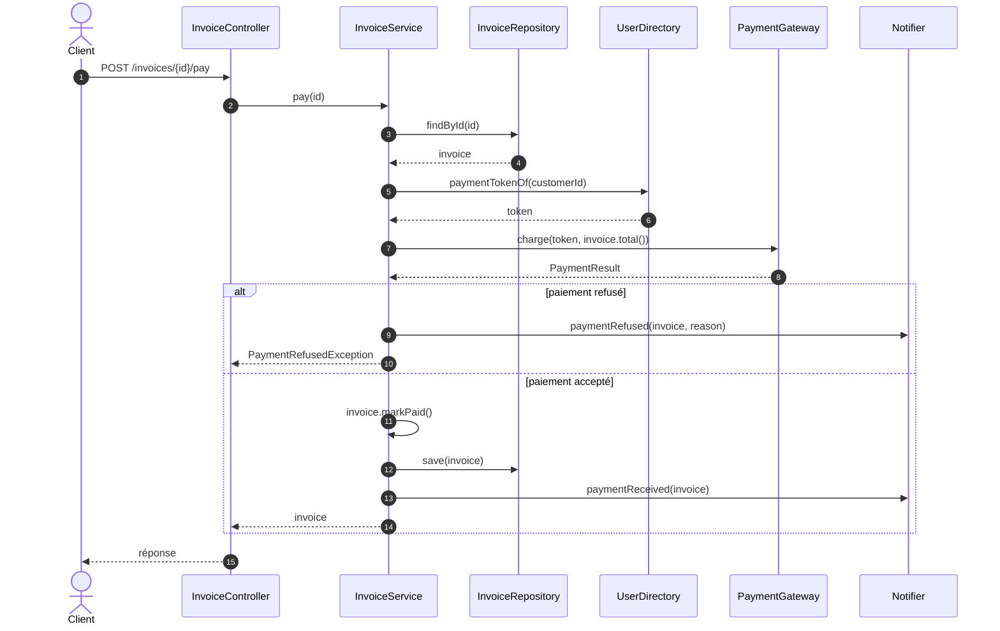

# Diagramme de séquence — paiement d'une facture

> **Module** : `billing` · **Type** : diagramme de séquence · **Question** : que se passe-t-il, et dans quel ordre, quand un client paie une facture ?

## Lecture

- Le débit auprès du PSP (étape 7) a lieu **avant** le contrôle de statut fait par `markPaid()`.
  Une facture `DRAFT`, `PAID` ou `CANCELLED` est donc débitée, puis `markPaid()` lève
  `IllegalStateException` : risque de double paiement, sans remboursement visible dans le code.
- Le statut n'est pas modifié en cas de refus : la facture reste `ISSUED` ou `OVERDUE`.
- Aucune transaction n'est visible : si `save` échoue après un débit accepté, la facture reste
  impayée en base alors que le client a été débité.
- `transactionId` est renvoyé par le PSP mais n'est ni stocké ni transmis.
- Hypothèse : le traitement HTTP de `PaymentRefusedException` (code de réponse) n'est pas visible ;
  le rôle `CUSTOMER` n'est indiqué qu'en commentaire.

## Sources

- `billing/src/main/java/com/shop/billing/InvoiceController.java` — `pay`, endpoint en commentaire
- `billing/src/main/java/com/shop/billing/InvoiceService.java` — `pay`
- `billing/src/main/java/com/shop/billing/Invoice.java` — `total`, `markPaid`
- `billing/src/main/java/com/shop/billing/PaymentGateway.java` — `charge`, `PaymentResult`
- `users/src/main/java/com/shop/users/UserDirectory.java` — `paymentTokenOf`
