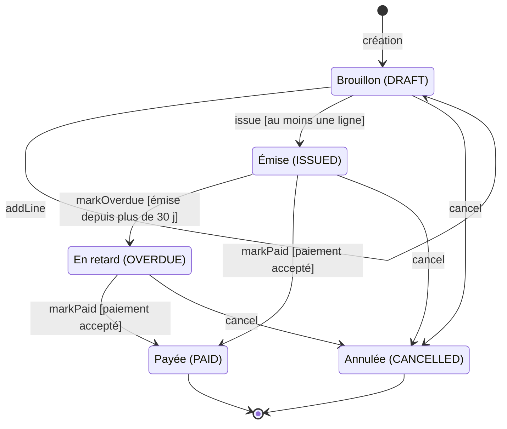

# Diagramme d'états — cycle de vie de la facture

> **Module** : `billing` · **Type** : diagramme d'états-transitions · **Question** : par quels états passe une facture (`Invoice`) et quelle opération la fait passer de l'un à l'autre ?

## Lecture

- Les transitions portent le nom de la méthode d'`Invoice` qui change le statut ; entre crochets, la
  garde vérifiée dans le code ou par l'appelant. Hors des transitions dessinées, chaque méthode lève
  `IllegalStateException`, sauf `markOverdue` qui ne fait rien en silence.
- Déclencheurs : `issue` vient de `POST /invoices/{id}/issue` (rôle ACCOUNTANT), `markPaid` de
  `POST /invoices/{id}/pay` (rôle CUSTOMER) une fois le débit accepté par `PaymentGateway`, et
  `markOverdue` d'`OverdueInvoiceJob`, tâche nocturne qui traite les factures émises depuis plus de
  30 jours. Si le paiement est refusé, la facture garde son état et `PaymentRefusedException` est
  levée.
- `PAID` et `CANCELLED` sont terminaux : aucune méthode n'en fait sortir. Un `cancel` sur une
  facture déjà annulée passe sans erreur et la laisse `CANCELLED` (boucle non dessinée).
- À confirmer : l'annulation n'est atteignable par aucun point d'entrée lu. Le commentaire
  d'`InvoiceController` annonce `POST /invoices/{id}/cancel`, mais ni le contrôleur ni
  `InvoiceService` n'appellent `cancel()`. La création d'une facture (état initial `DRAFT`, valeur
  par défaut du champ) n'est pas non plus visible dans le module.
- Constat lié : `InvoiceService.pay` débite le client avant que `markPaid` ne vérifie l'état. Payer
  une facture `DRAFT`, `PAID` ou `CANCELLED` encaisse donc le montant puis lève une exception sans
  enregistrer la facture.

## Sources

- `billing/src/main/java/com/shop/billing/InvoiceStatus.java` — les cinq états
- `billing/src/main/java/com/shop/billing/Invoice.java` — état initial, transitions et gardes (`addLine`, `issue`, `markPaid`, `markOverdue`, `cancel`)
- `billing/src/main/java/com/shop/billing/InvoiceService.java` — déclenchement d'`issue` et de `markPaid`, cas du paiement refusé
- `billing/src/main/java/com/shop/billing/InvoiceController.java` — endpoints et rôles (commentaire), absence d'appel à `cancel`
- `billing/src/main/java/com/shop/billing/OverdueInvoiceJob.java` — passage en retard après 30 jours
- `billing/src/main/resources/db/migration/V1__invoice.sql` — colonne `status` (`VARCHAR(16)`) qui persiste l'état
