# Catalogue des diagrammes UML en Mermaid

Les 14 types de diagrammes UML, ce que Mermaid sait en faire, à quels signaux dans le code on les
reconnaît, et les pièges de syntaxe qui empêchent l'affichage. Source de la liste des types :
[GitMind, types de diagrammes UML](https://gitmind.com/fr/types-diagrammes-uml.html).

Mermaid n'est pas un outil UML : il dessine bien cinq familles (`classDiagram`, `sequenceDiagram`,
`stateDiagram-v2`, `flowchart`, `erDiagram`) et les autres types UML s'obtiennent en détournant
`flowchart`. Un détournement est dit comme tel dans la section « Lecture » du fichier produit.

## Sommaire

1. [Table de correspondance](#table-de-correspondance)
2. [Signaux dans le code](#signaux-dans-le-code)
3. [Seuils de lisibilité](#seuils-de-lisibilité)
4. [Squelettes par type](#squelettes-par-type)
5. [Pièges de syntaxe](#pièges-de-syntaxe)

---

## Table de correspondance

| Préfixe de fichier | Type UML | Famille | Rendu Mermaid | Fidélité |
|---|---|---|---|---|
| `class` | Diagramme de classes | structure | `classDiagram` | native |
| `object` | Diagramme d'objets | structure | `classDiagram` avec instances | approchée |
| `component` | Diagramme de composants | structure | `flowchart` + `subgraph` | approchée |
| `deployment` | Diagramme de déploiement | structure | `flowchart` + `subgraph` | approchée |
| `package` | Diagramme de paquetage | structure | `flowchart` + `subgraph`, flèches pointillées | approchée |
| `usecase` | Diagramme de cas d'utilisation | comportement | `flowchart` (acteurs, frontière du système) | approchée |
| `activity` | Diagramme d'activité | comportement | `flowchart` (décisions, couloirs en `subgraph`) | approchée |
| `state` | Diagramme d'états-transitions | comportement | `stateDiagram-v2` | native |
| `sequence` | Diagramme de séquence | comportement | `sequenceDiagram` | native |
| `communication` | Diagramme de communication | comportement | `flowchart`, messages numérotés | approchée |
| `interaction` | Vue d'ensemble des interactions | comportement | `flowchart` dont les nœuds renvoient à des fichiers `sequence-*` | approchée |
| `er` | Modèle entité-association (hors UML) | structure | `erDiagram` | native |
| — | Diagramme de profil | structure | non représentable | à ne pas produire |
| — | Structure composite | structure | non représentable fidèlement | seulement sur demande, en `component` |
| — | Diagramme de temps | comportement | non représentable | seulement sur demande, en `state` ou `sequence` |

Le modèle entité-association n'est pas dans la liste UML, mais pour les données persistées il dit
ce que le diagramme de classes ne dit pas (clés, cardinalités en base). Il est proposé quand le
module a un schéma.

---

## Signaux dans le code

Choisir un diagramme parce que le module contient ce qu'il montre, jamais pour atteindre un nombre.

| Ce qu'on trouve dans le module | Diagramme | Question à laquelle il répond |
|---|---|---|
| Entités, objets-valeurs, agrégats, héritage, interfaces | `class` (domaine) | De quoi le module est-il fait et comment les concepts se rattachent-ils ? |
| Couches service / dépôt / adaptateur, injection de dépendances | `class` (services) ou `component` | Qui appelle qui, derrière quelles interfaces ? |
| Point d'entrée (contrôleur, handler, consommateur de messages, commande CLI, job) qui sollicite au moins trois collaborateurs | `sequence` | Que se passe-t-il, dans quel ordre, quand on déclenche ce scénario ? |
| Un champ ou une énumération de statut, un moteur de workflow, des transitions interdites | `state` | Quels sont les états d'un objet et qu'est-ce qui le fait passer de l'un à l'autre ? |
| Traitement avec branches, boucles, étapes parallèles : batch, pipeline, calcul métier, import | `activity` | Quel est l'enchaînement des étapes et où se décide-t-il ? |
| Plusieurs rôles, permissions, endpoints par profil | `usecase` | Qui peut faire quoi avec ce module ? |
| Dépendances vers d'autres modules, une base, une file, une API tierce | `component` | Où s'insère ce module et de quoi dépend-il ? |
| Dockerfile, compose, manifestes Kubernetes, Terraform, pipeline de déploiement | `deployment` | Sur quels nœuds tourne-t-il et comment ces nœuds se parlent-ils ? (vue d'ensemble si le fichier couvre toute l'application) |
| Entités ORM, migrations SQL, fichier de schéma | `er` | Quelles tables, quelles clés, quelles cardinalités ? |
| Nombreux paquetages qui se référencent, règles de couches | `package` | Comment le code est-il découpé et dans quel sens vont les dépendances ? |
| Échanges asynchrones où l'on s'intéresse aux liens plus qu'à l'ordre | `communication` | Qui parle à qui ? (rare) |
| Plusieurs `sequence` à enchaîner dans un scénario global | `interaction` | Comment les scénarios s'articulent-ils ? (rare) |
| Un jeu d'instances précis à illustrer (configuration, exemple de données) | `object` | À quoi ressemble un cas concret ? (rare) |

**Ensemble de départ d'un module ordinaire** : un `component` de contexte, un `class` du domaine,
un `sequence` du scénario principal. Ajouter `state`, `activity`, `usecase`, `er`, `deployment`
quand leur signal est présent. Un module de trois classes mérite deux diagrammes, pas huit.

**Vue d'ensemble de l'application** (`docs/diagrams/application/`) : `component` des modules et de
leurs dépendances externes, `deployment`, au besoin `usecase` (acteurs face aux modules) et
`sequence` d'un parcours transverse. Les nœuds et participants y sont des modules, des conteneurs,
des systèmes externes ou des acteurs ; une classe, une méthode ou une table y est un signe que le
diagramme appartient au dossier d'un module.

Un diagramme qui ne répond à aucune question qu'un lecteur se poserait n'est pas écrit.

---

## Seuils de lisibilité

Au-delà, le diagramme ne se lit plus : le scinder en plusieurs fichiers du même type, chacun avec
son sujet.

| Type | Seuil | Comment scinder |
|---|---|---|
| `class` | 10 classes ; membres utiles seulement (ni accesseurs, ni champs triviaux) | par agrégat, ou par couche |
| `sequence` | 8 participants, 25 messages | par scénario ; le nominal et les cas d'erreur séparés si plus de trois `alt` |
| `component`, `deployment`, `package`, `usecase`, `activity`, `communication`, `interaction`, `object` | 15 nœuds | par sous-système, ou par niveau (contexte, puis détail) |
| `state` | 12 états | par objet, ou en état composite détaillé à part |
| `er` | 10 entités | par groupe d'entités liées |

Les seuils sont des repères : un diagramme de 11 classes très homogènes peut passer, un de 7
classes bourrées de membres non.

---

## Squelettes par type

Chaque squelette est valide tel quel sur Mermaid 10 et plus. Les libellés visibles sont en français ;
les identifiants de code restent ceux du code.

### `class`

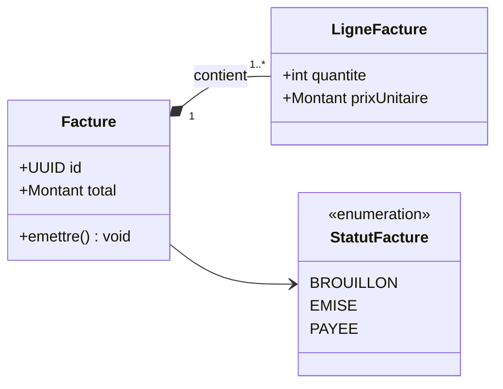

Relations : `<|--` héritage, `..|>` réalisation d'interface, `*--` composition, `o--` agrégation,
`-->` association, `..>` dépendance. Génériques : `List~Ligne~`.

### `object`

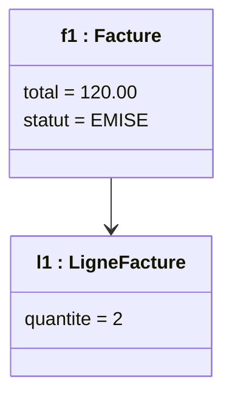

### `component`

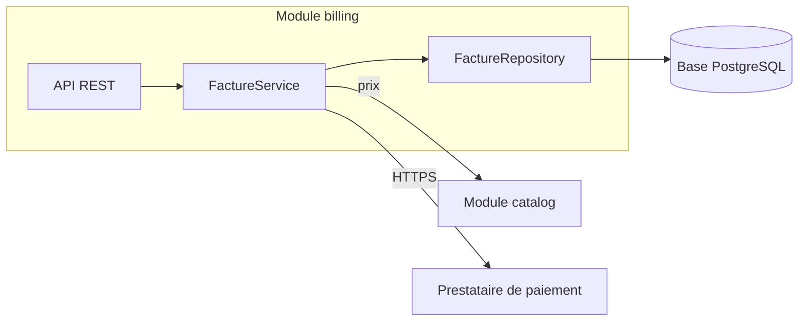

Base de données : `[( )]`. Système externe : nœud simple, nommé comme dans la configuration.

### `deployment`

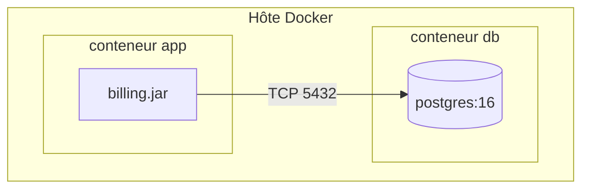

### `package`

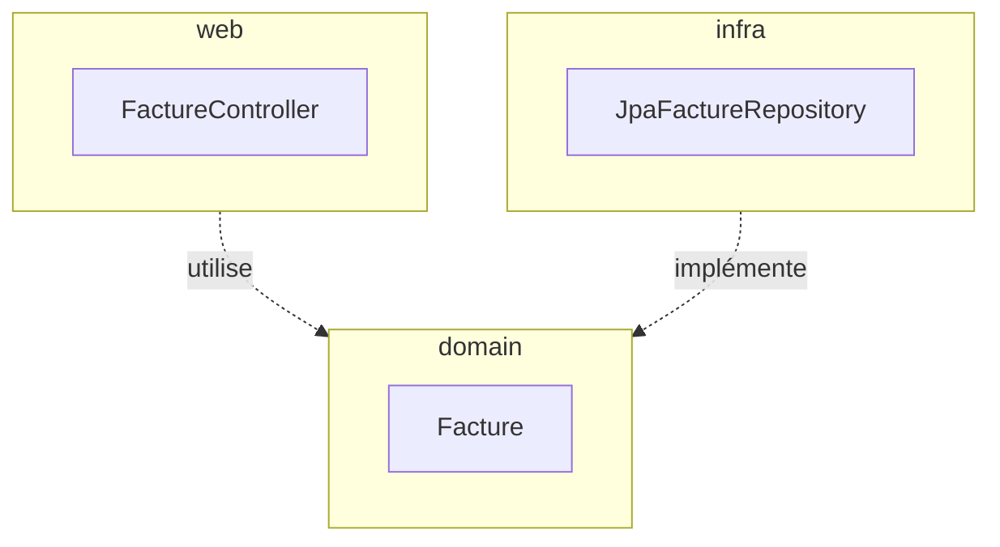

Flèche pointillée = dépendance. Sens : de celui qui dépend vers celui dont il dépend. Chaque
paquetage contient au moins un nœud représentatif : un `subgraph` vide fait échouer le rendu.

### `usecase`

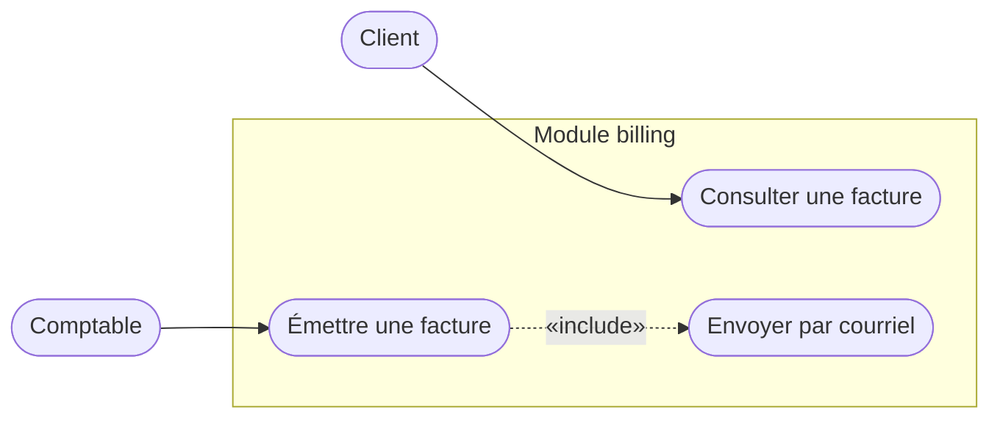

Acteur : nœud arrondi hors de la frontière. Cas d'utilisation : à l'intérieur du `subgraph`.
`«include»` et `«extend»` en libellé d'une flèche pointillée.

### `activity`

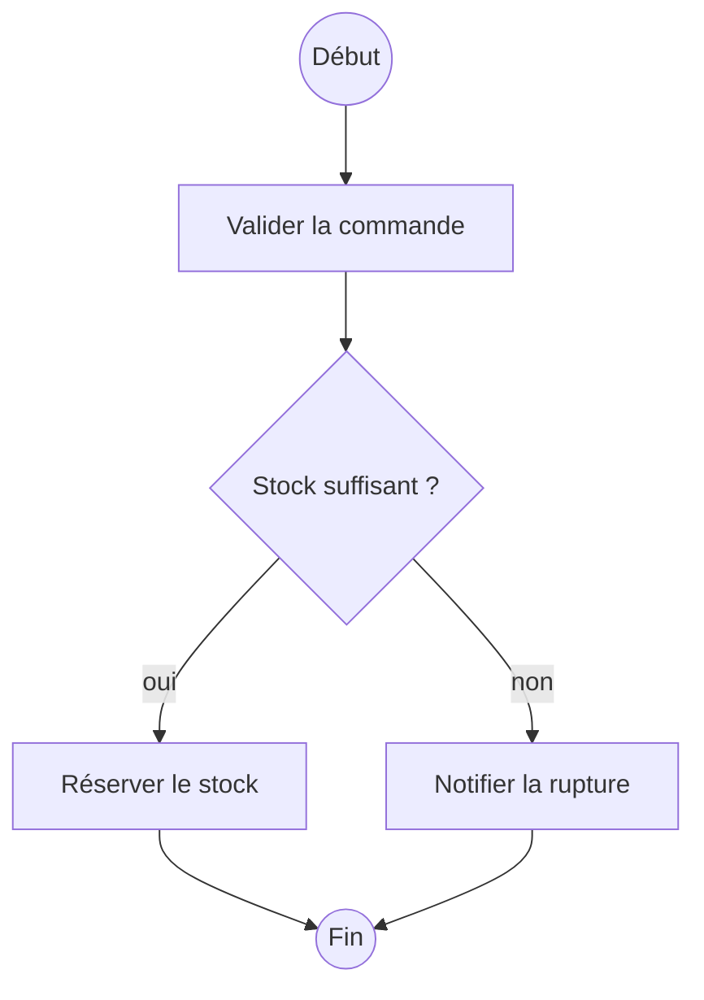

Couloirs : un `subgraph` par acteur. Parallélisme : une barre `fork["  "]` et une barre `join["  "]`
autour des branches.

### `state`

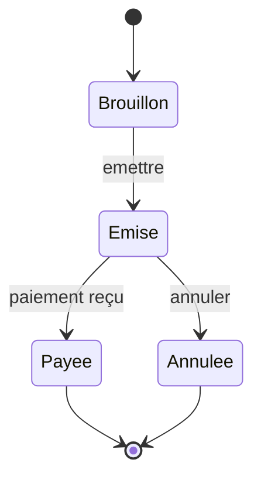

États composites : `state Emise { ... }`. Choix : `state c <<choice>>`.

### `sequence`

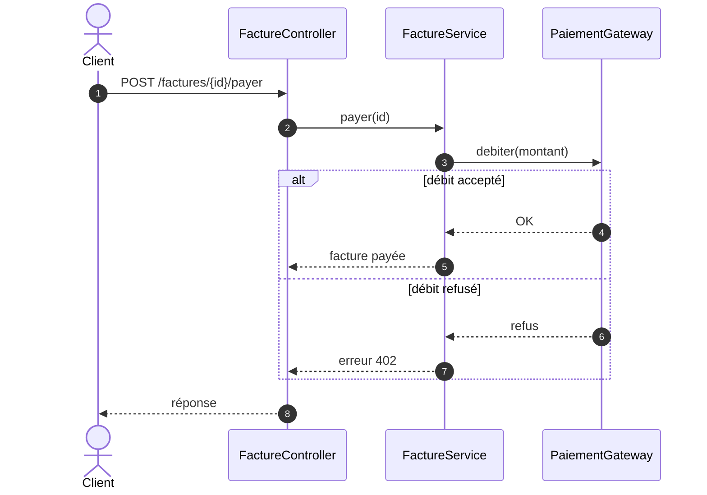

Flèches : `->>` appel, `-->>` retour, `-)` asynchrone, `-x` échec. Blocs : `alt/else`, `opt`, `loop`,
`par/and`. Chaque `alt`, `opt`, `loop`, `par` se ferme par `end`.

### `communication`

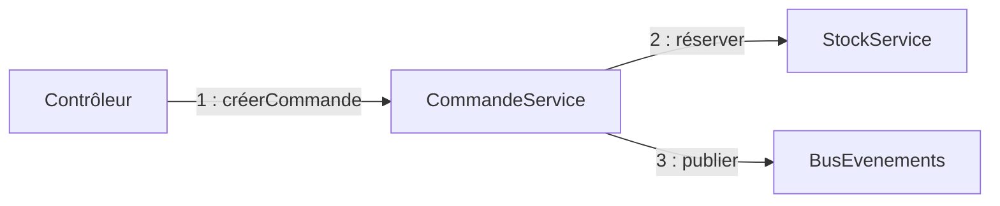

Détournement du `flowchart` : les numéros portent l'ordre, le dessin porte les liens.

### `interaction`

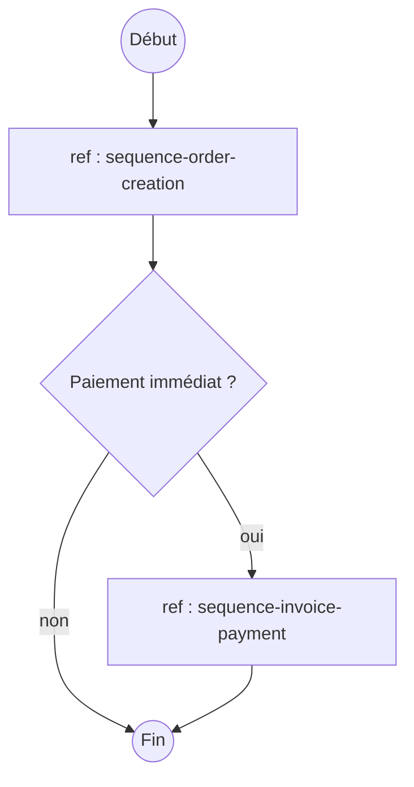

Chaque nœud `ref` porte le nom d'un fichier `sequence-*` existant du même module.

### `er`

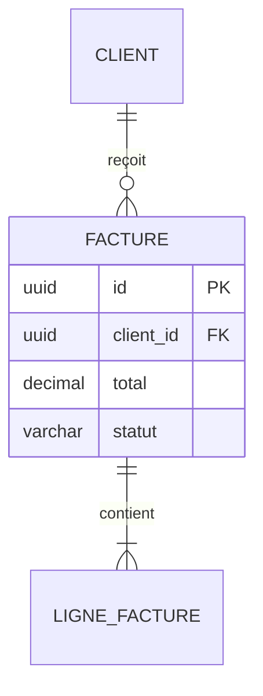

Cardinalités : `||` un exactement, `|o` zéro ou un, `}o` zéro ou plusieurs, `}|` un ou plusieurs.

---

## Pièges de syntaxe

Un diagramme qui ne s'affiche pas est pire que pas de diagramme : le lecteur perd confiance dans les
autres. Ces points causent l'essentiel des échecs.

| Piège | Effet | Remède |
|---|---|---|
| Parenthèses, crochets, accolades, guillemets, `#` dans un libellé de `flowchart` | erreur d'analyse | mettre le libellé entre guillemets : `A["f(x) > 0"]` |
| Nœud ou état nommé `end` en minuscules | ferme le bloc en cours | `End`, ou un identifiant sans signification de mot-clé |
| `A---oB` ou `A---xB` dans un `flowchart` | dessine un cercle ou une croix au lieu d'un nœud `oB` / `xB` | mettre un espace : `A --- oB` |
| Identifiant de nœud avec espace, accent ou tiret | erreur d'analyse | identifiant ASCII sans espace, libellé visible entre guillemets |
| `;` dans un message de `sequenceDiagram` | termine l'instruction | écrire `#59;` ou reformuler |
| `activate` sans `deactivate`, ou bloc `alt` sans `end` | erreur d'analyse | fermer chaque bloc ouvert |
| `subgraph` vide | échec du rendu (constaté sur Mermaid 12) | y mettre au moins un nœud |
| `<` et `>` bruts dans un libellé | interprétés comme HTML | écrire `&lt;` et `&gt;`, ou reformuler |
| Génériques `List<String>` dans un `classDiagram` | erreur d'analyse | `List~String~` |
| Type d'attribut `varchar(255)` dans un `erDiagram` | erreur selon la version | `varchar` |
| Sauts de ligne dans un libellé | selon le moteur | ` ` accepté partout où le HTML l'est ; sinon raccourcir |
| Directive `%%{init: ...}%%`, thèmes, `style`, `classDef`, `click` | ignorés ou bloqués par GitHub et GitLab | ne pas en mettre : le diagramme doit dépendre du moteur de rendu le moins possible |
| Libellés longs (plus de 40 caractères) | nœuds énormes, diagramme illisible | raccourcir, déplacer le détail dans « Lecture » |
| Plus de 15 flèches qui se croisent | spaghetti | scinder, ou changer `direction` |

Vérifier avec `python ${CLAUDE_SKILL_DIR}/resources/check_mermaid.py <dossier ou fichier>` : le script
détecte une partie de ces pièges. Il ne remplace pas un rendu réel.
